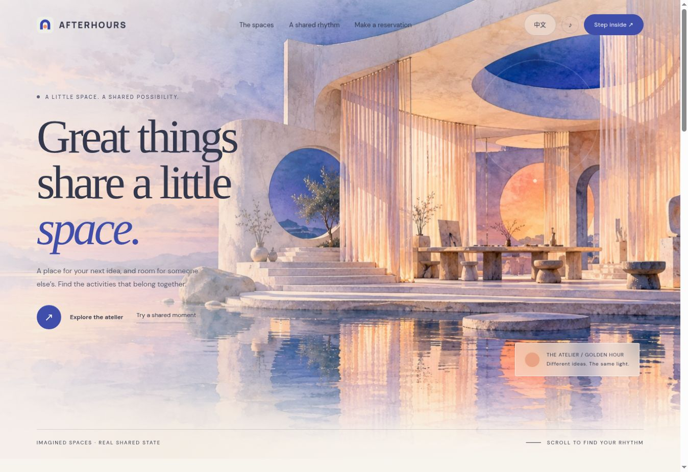

# AFTERHOURS

**Make room for each other.** A shared creative-space atelier where activities, not just time slots, determine whether people can coexist.

[Open the app](https://halihalibt.github.io/afterhours-genlayer/) · [Contract](contracts/afterhours.py) · [Protocol](PROTOCOL.md) · [Try it](DEMO.md) · [Live records](EVIDENCE.md)



A watercolor artist and an editor wearing headphones can share a room. A silence-dependent recording and an audible rehearsal cannot. AFTERHOURS turns those natural-language conditions into a shared, capacity-limited reservation record.

## What works

- Three concept spaces, four UTC time slots, party sizes and owner-controlled cancellation.
- GenLayer independently evaluates room rules and every active activity; deterministic code allocates capacity only after agreement.
- A revision guard protects the inspected slot against concurrent changes. Request IDs are namespaced by wallet and idempotent.
- Exact deployed-source verification, transaction-to-intent binding, finalized execution checks and matching state readback.
- A watercolor landing page, interactive Three.js atelier, moving light, room transitions, gentle piano music (enabled by default, starts when browser playback is permitted), reduced-motion support and English/Chinese copy.
- Guided examples are explicitly prewritten. The On chain workspace uses real Studionet reads and wallet-signed writes.

## Run locally

Node.js 22+ and Python 3.11+ are recommended.

```sh
npm ci
npm run dev
```

```sh
npm test
python -m unittest discover -s contract-tests -v
npm run build
```

The Python suite uses a mocked GenLayer host to test state invariants and validator rejection. It is not proof of live consensus. `genvm-lint validate contracts/afterhours.py` validates the pinned contract runner and ABI.

## Network and trust

Stable Studionet, chain **61999**, RPC `https://studio.genlayer.com/api`. The app checks chain identity and zero gas price before sending. Transfers are zero-value, full consensus is required, and the app does not automatically resubmit writes or appeal. Wallet signatures remain in the wallet; the application never requests a private key.

The deployed address and recorded examples live in [deployment.json](public/deployment.json). Transactions can be inspected and their complete receipts exported from the app. Availability reads use `LATEST_FINAL`.

## Scope and limitations

These are imagined spaces, not reservations at a real venue. The contract coordinates public participant declarations; it cannot verify actual noise, attendance or physical safety. Natural-language judgments can disagree or remain uncertain. There is no payment, credential verification, administrator override or automatic enforcement. Each owner may submit 64 requests, and each slot admits at most 64 request-history entries before new requests are blocked. Cancellations remain possible.

AFTERHOURS coordinates activities against an evolving capacity ledger. Existing reservations become inputs to the next admission decision.

## Stack

Vite, vanilla JavaScript, Three.js, genlayer-js 1.1.8 and a Python Intelligent Contract. No hosted application backend or paid model API key is needed. The atelier illustration was generated for this project; the interactive scene is original procedural geometry.

## Publishing

The Pages workflow runs both test suites, builds the app and publishes `dist/` on pushes to `main`. The build uses relative assets for subdirectory hosting. `npm run pages` also creates an optional local static copy in `docs/`.

MIT license. Copyright 2026 HALI.

The original 32-second piano miniature “Light through paper” is rendered by `scripts/render_music.py` and loops with soft room reflections. Music preferences persist locally. Browser autoplay restrictions may require a first click or keypress.
